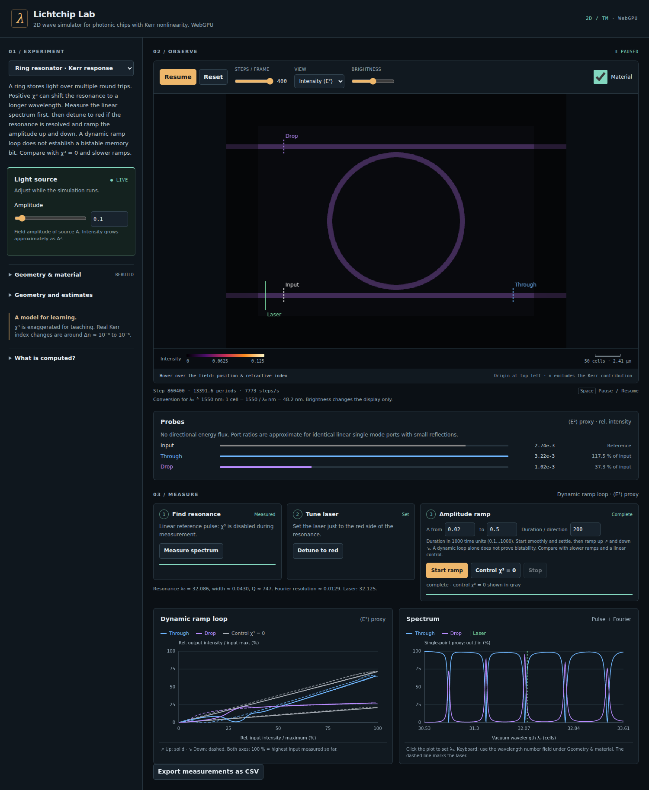

# Lichtchip Lab

A browser-based **2D wave simulator for photonic chips with Kerr nonlinearity, powered by WebGPU**. Explore waveguide coupling, ring resonances, self-focusing and interference. The simulator is a static site with ES modules: no build step, external libraries or CDN.

[Live demo](https://fmhc.github.io/lichtchip-labor/sim/) · The site root `/` redirects to `/sim/`, preserving the query string and fragment.



## Run locally

From the repository root:

```sh
python3 -m http.server 8790
```

Open <http://localhost:8790/sim/>. WebGPU requires **HTTPS or localhost**, an available GPU adapter and compatible browser/GPU drivers. A browser name alone does not guarantee WebGPU support. There is no CPU fallback.

## Experiments

| Preset | Experiment |
|---|---|
| `coupler` | Nonlinear directional coupler: compare linear cross-port transfer with the Kerr response during an amplitude ramp. |
| `ring` | Kerr ring resonator with through and optional drop ports: measure a linear spectrum, apply red detuning and compare nonlinear and linear ramps. |
| `soliton` | Self-focusing in a homogeneous Kerr material, with a paraxial spatial soliton estimate. Constant beam width is not validated. |
| `xor` | Two-input interference in a linear 3-dB coupler, inspired by the WaveDude XOR demonstration. Output depends on input phase and amplitude; it does not restore clean logic levels. |

Source amplitudes and phase can be adjusted live. Geometry, material, wavelength and Kerr-model changes rebuild the scene. Space pauses/resumes outside controls. A spectrum plot click sets the wavelength; the wavelength number field also supports keyboard input. Measurements can be exported as CSV.

## Model and limits

The model solves the scalar **2D TM** Maxwell wave equation for an out-of-plane electric field E_z:

```text
∂²D/∂t² = ∇²E
D = εE + χ³ N E
N = E²                         (instantaneous Kerr)
dN/dt = (E² − N) / τ           (Debye relaxation)
```

The solver uses an isotropic 9-point Laplacian, leapfrog stepping with Δt = 0.5 cells/c and a sponge/absorbing layer. Sources inject the fundamental mode consistently with the same stencil. The mode solver supplies the propagation constant and effective index. Lengths are in grid cells; the display provides an illustrative physical conversion assuming λ₀ corresponds to 1550 nm.

**χ³ is exaggerated for teaching.** Real Kerr index changes are typically around Δn ≈ 10⁻⁸…10⁻⁶. The model makes effects visible over a few hundred wavelengths; it is not a calibrated chip design or fabrication tool. A real device also requires its vertical geometry and a 3D calculation. Only χ³ ≥ 0 is accepted. With n ≥ 1, χ³ ≥ 0 and Δt = 0.5, the differential permittivity provides a CFL stability margin. The kernel checks the material-solver residual and finite fields; detected faults visibly stop the simulation.

Debye is a **qualitative local relaxation model**. It omits heat diffusion, absorbed heating power, heat capacity, carrier generation and free-carrier absorption. Fundamental-frequency estimates use the continuous-time real coefficient c(τ) = ½ + 1/[4(1+(2ωτ)²)], omitting quadrature and time-discretization errors. Only for ωτ ≫ 1 does c ≈ ½; instantaneous Kerr uses c = ¾.

Probes report a smoothed **⟨E²⟩ proxy** for relative intensity, summed along a line. Spectra use one cell per port. Ratios approximate power transmission only for identical linear single-mode ports with small reflections. Directional energy flux is not measured.

The reference pulse runs with χ³ = 0, then restores the material response. A quality factor **Q** is reported only when both interpolated half-depth crossings are supported by a local baseline. The linewidth must exceed twice the Fourier resolution λ²/T, with baseline support at least two fitted widths on each side. In each recorded channel, the final tenth of the signal must contain at most 10⁻⁴ of the E² in the strongest equal-length interval. These guards do not replace convergence studies or a validated resonance fit.

A **dynamic ramp loop is not proof of bistability**. Ramps start smoothly and include a settling interval, but lag can produce a loop even at χ³ = 0. Compare slower ramps or stationary measurements and the gray linear control (`sweep=1&control=1`). Ring Q, stationary bistability, soliton width and real chips are not validated. Observed decay is not established model physics without grid, time-step and boundary convergence.

## URL parameters and accepted inputs

Append parameters to `sim/index.html`, for example `?preset=ring&steps=8000&spf=200&view=1`.

| Parameter | Meaning / range |
|---|---|
| `preset=coupler\|ring\|soliton\|xor` | Experiment; default `coupler`. |
| `p.<param>=value` | Override a preset parameter within its slider bounds in `sim/js/presets.js`; `p.drop` is integer 0 or 1. |
| `view=0\|1\|2` | Signed field, intensity or logarithmic intensity. |
| `spf=1…400` | Integer steps per frame. |
| `steps=1…2000000` | Stop after this integer number of steps. |
| `spectrum=1` | Measure the ring’s linear reference spectrum. |
| `detune=1` | Apply red detuning after the spectrum; use with `preset=ring&spectrum=1`. An unresolved resonance blocks automatic detuning. |
| `sweep=1` | Run the preset’s amplitude ramp. |
| `control=1` | Run the nonlinear ramp followed by a linear control in the same plot; can follow a spectrum measurement. |
| `log=1` | Log step counts and probe values to the console. |
| `selftest` | Run the physics self-test instead of the interactive simulator. |
| `diag&A=1.1&chi3=0.5&tau=30&steps=30000` | Coupler diagnostic: column-wise ⟨E²⟩ sums. `A`: 0…2.5; `chi3`: 0…2; `tau`: 0…1000 optical periods (0 = instantaneous, otherwise τ ≥ Δt); `steps`: 1…2000000. |
| `checks=lifecycle\|nogpu\|lost\|validation` | Browser regression scenarios interpreted by `tools/run_page.py` on the test host. |

Numeric inputs must be finite; empty values are rejected. Boolean numeric flags above must equal 1. The UI response time is 0.05…1000 optical periods, with Δt/τ ≤ 1 for Debye. Ramp amplitudes must satisfy 0 ≤ min < max ≤ the preset amplitude limit; duration per direction is 0.1…1000 in units of 1000 simulation time units.

Grid dimensions must be safe integers, at most 8192 per axis and 3 million cells in total, subject to device limits. Cell, buffer/binding, dispatch and canvas limits are checked before rasterization and GPU allocation. The conservative build budget is 480 MB for two scenes including CPU maps. Failed builds retain the previous scene and accepted parameters.

## Self-test

Open `sim/index.html?selftest`. The title becomes `PASS selftest` or `FAIL selftest`; exceptions produce `ERR selftest`. Tests compare against closed-form discrete results or the matching mode solver:

| Test | What it checks |
|---|---|
| T1 | Linear plane-wave wavenumber (relative error < 0.002), injected amplitude (relative error < 0.03) and absorbing-layer amplitude reflection (< 0.01). |
| T2 / T3 | Weak nonlinear wavenumber shift for slow Debye / instantaneous Kerr, within 3% of the fundamental-frequency estimate, with finite amplitudes. |
| T2b | Slow Debye at higher power in a homogeneous medium: finite amplitudes, reflection < 0.01 and wavenumber-shift deviation < 3%. |
| T4 | Waveguide FDTD wavenumber versus the 9-point-consistent mode solver (relative error < 0.001); launched fundamental-mode amplitude within 1% and residual transverse energy < 1%. |
| T5 | Linear directional coupler: more than 90% of the summed output proxy reaches the cross port. |
| T6 | Kerr coupler diagnostic only; reports output ratios without validating a switching threshold. Nonfinite coupler fields still fail the self-test. |

Coupler and soliton amplitude estimates are also logged for reference. These checks do not validate all presets or establish quantitative nonlinear device performance.

## Project structure

```text
index.html                 Redirect to sim/
.nojekyll                  Static hosting marker
LICENSE                    MIT license
sim/index.html             Simulator UI
sim/css/lab.css            Responsive layout and styling
sim/js/app.js              Controls, measurement sequences and lifecycle
sim/js/engine.js           WebGPU kernels and field evolution
sim/js/scene.js            Geometry rasterization, mode solver, sources and probes
sim/js/presets.js          Experiments, parameter limits and estimates
sim/js/validation.js       Shared URL/UI and allocation limits
sim/js/spectrum.js         DFT and resonance guards
sim/js/selftest.js         Physics self-test and column diagnostic
sim/js/ui-lab.js           UI guidance, scales and workflow state
sim/js/ui-plots.js         Transfer and spectrum plots
sim/probe/index.html       Minimal WebGPU adapter probe
tools/                     Remote browser test tools
docs/screenshot-ring.png   Ring experiment screenshot
```

## Remote test tools

Copy `tools/remote.env.example` to `tools/remote.env` and set the SSH target, working directory and port. This local configuration is ignored by Git and excluded from synchronization. Environment variables `LICHTCHIP_REMOTE`, `LICHTCHIP_REMOTE_DIR` and `LICHTCHIP_PORT` take precedence. An SSH alias can encapsulate the user and host. Configuration uses plain `KEY=value` lines, not executable shell code.

The launcher needs Bash, SSH and rsync. The test host needs Bash, Python 3, an existing `venv/` with Playwright and its Chromium, and working Vulkan/WebGPU drivers. The tools install nothing.

```sh
tools/remote_run.sh 'index.html?selftest' selftest.png 240 1500x950
tools/remote_run.sh 'index.html?preset=ring&spectrum=1&detune=1&sweep=1&control=1&spf=400&view=1' ring.png 400
tools/remote_run.sh 'index.html?preset=ring&checks=lifecycle&spf=400' lifecycle.png 180
tools/remote_run.sh 'index.html?preset=ring&steps=8000&spf=200&view=1' mobile.png 180 420x900@1
```

Run GPU jobs sequentially on shared devices. Timeout: 1…3600 seconds; viewport: 320…3840 × 320…2160; DPR: 1…3.9. Screenshots are copied to `shots/`; page output and logs are printed to stdout. Redirect stdout/stderr if persistent text logs are needed. Screenshots are retrieved even when the page test fails.

`tools/browser_checks.py` covers reset/preset changes during measurement, failed-allocation recovery, input rejection, DFT equivalence and cancellation, and linewidth guards. It also provides missing/lost GPU and GPU-validation-error scenarios. The launcher returns nonzero for FAIL, ERR, unexpected titles, transfer failures or timeouts. Consequently, deliberate negative tests such as `?spf=Infinity` and `?checks=nogpu` return exit code 1 even when the intended error is correctly displayed; inspect their title and check output.

## Acknowledgments

Inspired by **WaveDude Next by A. Gräf (GPL-3)** and **Wave Dude 2D by J. Vleggaar**. Lichtchip Lab was independently written; no code was copied from these projects. Their licenses do not determine this project’s license.

## License

MIT, see [LICENSE](LICENSE).
